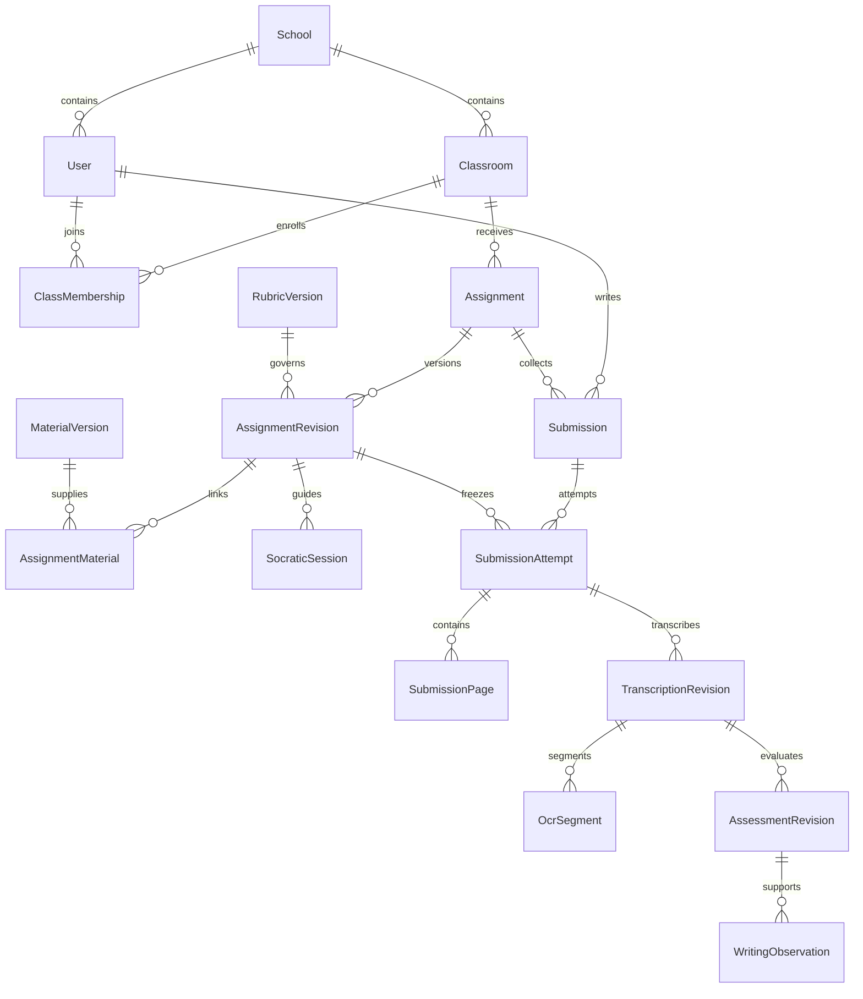

# Mô hình dữ liệu EduLit-AI

Ngày: 12/10/2026. Đây là thiết kế logical cho PostgreSQL/Prisma, chưa phải migration đã thực thi. Bổ sung cho [SRS](../../SRS.md) và [system design](system-design.md).

## 1. Quy ước

- Khóa nội bộ UUID; mã đề là thuộc tính tra cứu, không dùng làm quyền truy cập.
- Timestamp lưu UTC, hiển thị theo timezone của trường/người dùng; không dùng timezone máy chủ làm hạn nộp.
- Mỗi tài nguyên có scope trường/lớp và owner phù hợp. Composite foreign key hoặc validation transaction ngăn tham chiếu khác scope.
- Điểm PostgreSQL `numeric`, tính bằng decimal hoặc đơn vị nguyên theo score step, không cộng float rồi bỏ qua sai lệch.
- JSONB dành cho payload versioned (rubric, báo cáo, snapshot), không thay các quan hệ cần constraint hoặc index.
- Revision đã dùng khi giao đề/nộp/chấm là bất biến. `updatedAt` không thay thế lịch sử revision.

## 2. Entity và quan hệ

| Entity | Thuộc tính chính / quan hệ | Chủ sở hữu |
| --- | --- | --- |
| `School` | id, name, timezone | classrooms |
| `User` | id, schoolId, loginId, passwordHash, role, status | identity |
| `AuthSession` | id, userId, tokenHash, expiresAt, revokedAt | identity |
| `Classroom` | id, schoolId, code, gradeLevel, academicYear | classrooms |
| `ClassMembership` | classroomId, userId, membershipRole, status | classrooms |
| `FileAsset` | id, scope, ownerId, storageKey, mime, bytes, checksum, privacyStatus, expiresAt | module tải file; storage adapter chỉ giữ bytes |
| `Material` / `MaterialVersion` | classId, title; revision, fileId/text, status, privacyReview, parserVersion | grounding |
| `MaterialChunk` | materialVersionId, section, pageRef, order, text, sourceRef | grounding |
| `Rubric` / `RubricVersion` | classId; version, criteria JSONB, maxScore, scoreStep, status, approvedBy/At | grounding |
| `Assignment` / `AssignmentRevision` | classId, code; instructions, genre, deadline, learningGoals, rubricVersionId, publishedAt | assignments |
| `AssignmentMaterial` | assignmentRevisionId, materialVersionId | assignments |
| `SocraticSession` | studentId, assignmentRevisionId, state, version, lastMessageAt | socratic |
| `ChatMessage` | sessionId, turnId, role, content, sources, status, aiRunId | socratic |
| `OutlineRevision` | sessionId, revision, sections, author/source refs, reviewStatus | socratic |
| `Submission` | studentId, assignmentId, selectedAttemptId | assessment |
| `SubmissionAttempt` | submissionId, attemptNumber, assignmentRevisionId, outlineRevisionId?, state, submittedAt | assessment |
| `SubmissionPage` | attemptId, pageIndex, assetId, checksum, privacyReviewedBy/At | assessment |
| `TranscriptionRevision` | attemptId, revision, status, reviewedBy/At, aiRunId? | assessment |
| `OcrSegment` | transcriptionRevisionId, pageId, segmentId, order, text, needsReview, reviewReason, confidence?, confidenceSource | assessment |
| `OcrReviewIssue` | studentId, segmentRef, note, resolvedBy/At, resolution | assessment |
| `AssessmentRevision` | attemptId, transcriptionRevisionId, rubricVersionId, aiProposal, finalResult, status, reviewedBy/At, publishedAt, aiRunId | assessment |
| `StudentDeclaredGoal` | studentId, target, selfReportedStrength/Difficulty, updatedAt | writing-profile |
| `WritingObservation` | studentId, kind, feature, genre, assessmentRevisionId, evidenceRefs, supportCount, eligibleCount, status | writing-profile |
| `WritingProfileSnapshot` | studentId, revision, activeObservationIds, progressSummary, builtAt | writing-profile |
| `AnalyticsRecommendation` | classId, assignmentId, aggregateSnapshot/hash, promptVersion, proposal, aiRunId | analytics |
| `AiRun` | task, model, prompt/schemaVersion, inputHash, status, usage, latency, providerError, correlationId | infrastructure/ai |
| `UsageReservation` | user/project, taskKey, estimatedTokenBudget, status, actualUsage | infrastructure/ai |
| `IdempotencyRecord` | userId, route, keyHash, requestHash, state, resourceId/response, expiresAt | core request boundary |
| `OutboxEvent` | eventType, scope, aggregateId/revision, payload IDs, dispatchedAt | producer module |
| `AuditEvent` | actorId, action, resourceId/version, timestamp, reason | core audit |

`FileAsset` là logical metadata chung; mutation do module sở hữu use case upload thực hiện. `storageKey` không lộ ra HTTP contract. Outbox/job payload chỉ chứa ID/version, không chép nguyên bài làm hoặc định danh học sinh.

## 3. Quan hệ cốt lõi

## 4. Constraint và index cần triển khai

- Unique membership `(classroomId, userId)`; unique login `(schoolId, loginId)`; unique assignment code `(schoolId, code)`.
- Unique rubric/material/assignment revision `(aggregateId, version)`; chỉ published revision được chọn khi khởi tạo phiên hoặc submit.
- Unique submission `(assignmentId, studentId)`; unique attempt `(submissionId, attemptNumber)`; unique page `(attemptId, pageIndex)`; 1–4 trang và page order kiểm tra khi freeze attempt.
- `selectedAttemptId` phải thuộc chính submission và có assessment hiện hành đã công bố. Bài nộp mới đang chờ chấm không tự xóa kết quả trước trong báo cáo.
- Unique transcription revision `(attemptId, revision)`; unique segment `(transcriptionRevisionId, segmentId)`; segment references luôn đi cùng transcription revision.
- Unique logical AI task `(task, inputHash, promptVersion, schemaVersion, model)` cho kết quả thành công có thể tái dùng; không dùng unique này để cấm retry run thất bại. Mỗi execution có ID riêng và task key chung.
- Unique active/publication pointer cho assessment của attempt; lịch sử assessment giữ đầy đủ, thay pointer trong transaction khi công bố lại.
- Foreign keys: assessment rubric phải bằng rubric đã chốt trong assignment revision của attempt; reference consistency kiểm tra trong transaction và constraint khả thi.
- Index theo `(classId, status)`, `(studentId, assignmentId)`, `(attemptId, state)`, `(studentId, genre, observedAt)`, outbox chưa giao, assets đến hạn xóa và session expiry.
- Lock/version khi sửa rubric draft, outline, chốt attempt, publish assessment. Request dùng `expectedVersion`; xung đột trả `409` thay vì ghi đè.

## 5. Lifecycle

| Aggregate | Trạng thái / chuyển tiếp |
| --- | --- |
| MaterialVersion | `UPLOADED → PRIVACY_REVIEW → PROCESSING → READY`; lỗi xử lý → `FAILED` |
| RubricVersion | `DRAFT → APPROVED`; thay đổi sau approve tạo version mới |
| AssignmentRevision | `DRAFT → PUBLISHED → CLOSED`; việc đóng không xóa lịch sử |
| SubmissionAttempt | `DRAFT → PRIVACY_REVIEW → QUEUED → OCR_PROCESSING → OCR_REVIEW → READY_TO_GRADE → GRADING → ASSESSMENT_REVIEW → PUBLISHED` |
| Attempt ngoại lệ | Từ bước nền → `FAILED`; retry về đúng bước với cùng input; privacy failure → `PRIVACY_REVIEW`; rút kết quả → `WITHDRAWN` |
| TranscriptionRevision | `DRAFT → REVIEW_REQUIRED → CONFIRMED`; sửa bản đã xác nhận tạo revision mới |
| AssessmentRevision | `AI_DRAFT → TEACHER_REVIEW → PUBLISHED`; rút → `WITHDRAWN`, thay thế → `SUPERSEDED` |
| Observation | `PROVISIONAL → SUPPORTED`; có thể `RESOLVED`, `INVALIDATED`; giữ lịch sử bằng chứng |

MVP dùng trạng thái review ngay cả khi model báo đọc rõ. Giáo viên xác nhận OCR để chấm; học sinh chỉ báo lỗi. OCR sửa sau chấm làm assessment cũ `SUPERSEDED`/không còn hiện hành và cần chấm lại trước công bố; revision cũ vẫn có thể xem trong audit.

## 6. Rubric, điểm và báo cáo

`weight` trong SRS là điểm tối đa, không nhân thêm. Server xác nhận tập criterion IDs đúng và duy nhất, mỗi điểm trong giới hạn, tổng criteria maxima bằng rubric max, tổng điểm cấp bằng tổng các tiêu chí. Điểm/xếp loại trong UI lấy từ final result đã công bố.

Score step, đếm lỗi trùng và mức trừ được lưu ở rubric version được giáo viên duyệt. Không tự áp dụng `0.25` cho mọi rubric. Tổng điểm do server tính từ điểm từng tiêu chí đã hợp lệ; nếu model gửi tổng khác phải đánh dấu sai, không công bố âm thầm. Không biến “khác đáp án mẫu” thành lỗi nếu rubric chấp nhận lập luận có căn cứ.

MVP báo cáo chính thức chọn một final assessment hiện hành cho `selectedAttemptId` của mỗi student/assignment. Tách bộ đếm submitted, pending, reviewed/published, failed; mẫu số phân bố là số final assessments hợp lệ. Khi nộp lại được phép, teacher chọn attempt đã công bố; cả lớp không đếm hai bài của cùng em như hai học sinh.

Taxonomy heatmap dự kiến: `STRUCTURE`, `ARGUMENT`, `LANGUAGE`, `CREATIVITY`, kèm code lỗi và applicability theo rubric. Tần suất là số bài có lỗi / số bài phù hợp để đánh giá tiêu chí; occurrence count lưu riêng. Độ đạt mục tiêu chỉ tính khi learning goal có criterion mapping và ngưỡng do giáo viên đặt; thiếu mapping trả chưa đủ dữ liệu.

## 7. Profile và quyền riêng tư

Evidence dùng `{assessmentRevisionId, transcriptionRevisionId, pageId, segmentId, quote}`. Quote phải tồn tại trong segment được xác nhận; snapshot mô tả chỉ dựa trên observations còn hiệu lực. Không đưa profile vào tính điểm bài mới để tránh thiên kiến; profile phục vụ cách hướng dẫn và bài luyện.

Không gắn confidence “cao” chỉ vì đủ bốn bài. Lưu số bài hỗ trợ, số bài có cơ hội quan sát, độ đa dạng genre và thời gian gần nhất. Chat/dàn ý giúp nhận biết cách tương tác nhưng không tự trở thành bằng chứng văn phong bài tự viết.

Retention/xóa cần bao phủ ảnh, văn bản, messages, observations, snapshots, recommendation cache, provider-uploaded files và dữ liệu trong backup theo thời hạn riêng. Soft delete không tương đương xóa dữ liệu. Tách identity khỏi context gửi model; mã giả danh vẫn là dữ liệu cần bảo vệ.
