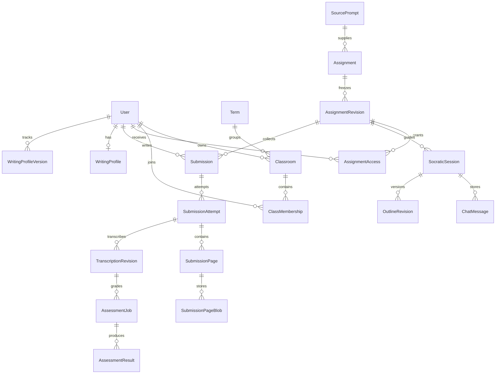

# Mô hình dữ liệu EduLit-AI

Rà lại **2026-10-28** theo model SQLAlchemy trong `backend/app/db/models/` và Alembic `0001`–`0022`. Đây là mô tả schema Python hiện có; các ý tưởng chưa có bảng thực thi được ghi riêng ở cuối. Không khẳng định migration đã chạy trên database cụ thể trong đợt rà tài liệu này.

## 1. Quy ước hiện tại

- Khóa nội bộ UUID, timestamp có timezone. Mã đề dùng tra cứu; quyền nằm ở owner/membership và `assignment_access`.
- Các snapshot/payload có cấu trúc dùng JSONB. Điểm, thang điểm và bước điểm trong rubric/assessment dùng `NUMERIC(8,2)`; validator nghiệp vụ kiểm tra tổng và giới hạn.
- Bytes gốc của tài liệu và ảnh nằm trong bảng blob PostgreSQL riêng, không phải tài nguyên frontend public.
- Phiên bản đề, bản chép và kết quả đã công bố có con trỏ/lịch sử riêng; không dùng `updated_at` thay toàn bộ lịch sử.

## 2. Bảng/model đang có

| Nhóm | Model / bảng | Quan hệ và nội dung |
| --- | --- | --- |
| Identity | `User`, `AuthSession`, `AuthToken`, `RateLimitBucket` | User có login/email duy nhất, role/status, password hash, email verification timestamp; session/token lưu hash và hạn dùng |
| Học kỳ/lớp | `Term`, `Classroom`, `ClassMembership` | Lớp thuộc kỳ học và giáo viên sở hữu; mã tham gia, trạng thái tham gia, membership theo user |
| Catalog | `Topic`, `Material`, `MaterialVersion`, `MaterialChunk` | Ngữ liệu thuộc giáo viên/chuyên đề; phiên bản nội dung và chunks có thứ tự |
| Đề nguồn | `SourcePrompt`, `SourcePromptMaterial` | Yêu cầu viết đầy đủ/tóm tắt/hướng dẫn, liên kết các ngữ liệu |
| Barem | `Rubric`, `RubricVersion` | Phiên bản tiêu chí JSONB, max score, score step, status |
| Import | `TeacherDocument`, `TeacherDocumentBlob` | File gốc, Markdown chuyển đổi/giáo viên sửa, hash phân tích, draft, danh sách mục được confirm; trạng thái OCR PDF scan (`ocr_status`, lease, tiến độ trang) |
| Giao bài | `Assignment`, `AssignmentRevision`, `AssignmentAccess` | Draft bài tập, người nhận, hạn nộp, `late_policy`, `due_extensions`, `max_revisions`, `revision_due_at`; published revision giữ instructions/rubric/context/snapshot; quyền theo revision + học sinh |
| Chuẩn bị dàn ý | `StudentOutlinePrep` | Job theo revision + học sinh, outline, trạng thái, lease/token và số lần thử |
| Socratic | `SocraticSession`, `ChatMessage`, `OutlineRevision`, `IdempotencyRecord` | FSM, reservation, logical turn, lịch sử chat, outline version và phản hồi replay |
| Bài nộp | `Submission`, `SubmissionAttempt` | Một submission theo revision + học sinh; nhiều attempt; `revision_round` trên từng lượt; con trỏ attempt/job/result/published result hiện hành; `published_history` trên submission |
| Trang/OCR | `SubmissionPage`, `SubmissionPageBlob`, `OcrResult`, `TranscriptionRevision` | Thứ tự/hash ảnh, bytes ORIGINAL/PROCESSED; output OCR và bản chép có revision; segments lưu trong JSONB |
| Chấm | `AssessmentJob`, `AssessmentResult` | Job gắn attempt + transcription; kết quả giữ AI/teacher/published payload, version, điểm, actor/thời gian công bố và `superseded_at` |
| Phân tích lớp | `ClassInsight` | Scope/mode/filter fingerprint, hash số liệu đầu vào, trạng thái/lease, payload gợi ý |
| Hồ sơ viết | `WritingProfile`, `WritingProfileVersion` | Cache theo học sinh/source hash; payload, analyzed sources; lịch sử version/summary/traits/evidence counts |

Vị trí: identity có file model riêng; catalog trong `catalog.py`; đề revision/chat/outline trong `socratic.py`; submission/OCR trong `submission.py`; chấm/insight trong `assessment.py`; profile trong `writing_profile.py`.

## 3. Quan hệ chính

## 4. Constraint và kiểm tra phiên bản

Những unique constraint đã có trong model gồm:

- `users.login_id`, `users.email`; `terms.code`; classroom `(term_id, subject, code)`; membership `(classroom_id, user_id)`.
- Material version `(material_id, version)`, chunk `(material_version_id, chunk_id)`, rubric version `(rubric_id, version)`; assignment code duy nhất.
- Assignment access `(assignment_revision_id, student_id)`; submission cũng theo revision + student, không có `school_id` trong schema hiện tại.
- Attempt `(submission_id, attempt_number)`, page `(attempt_id, page_index)`, transcription `(attempt_id, revision)`.
- `assignments.late_policy` thuộc `ALLOW_LATE` hoặc `CLOSE_AT_DUE`. `assignments.max_revisions` từ 0 đến 2. `submission_attempts.revision_round >= 1`. `teacher_documents.ocr_status` thuộc `NONE`, `QUEUED`, `PROCESSING`, `DONE`, `FAILED`. Index một phần `teacher_documents_ocr_claim_idx` trên `ocr_status` khi giá trị là `QUEUED` hoặc `PROCESSING`.
- Outline `(session_id, revision)`, chat `(session_id, turn_id, role)`; idempotency key có scope user/route.
- Profile history `(student_id, version)`; insight `(teacher_id, scope_key, mode)`.

Quy tắc bounds/điểm, quyền truy cập, input revision và lease còn được kiểm tra trong service, không phải tất cả đều là constraint SQL. Sửa outline dùng `expectedVersion`; sửa/xác nhận bản chép kiểm tra revision; lưu/công bố/ẩn kết quả dùng `resultId` + `transcriptionRevisionId` + `expectedVersion`.

## 5. Lifecycle thực thi

| Dữ liệu | Trạng thái/ý nghĩa |
| --- | --- |
| TeacherDocument | `UPLOADED`, `CONVERTING`, `CONVERTED`, `ANALYZING`, `REVIEW`, `CONFIRMED`; lỗi `FAILED`, PDF không có chữ `NEEDS_OCR`. `ocr_status` riêng: `NONE`, `QUEUED`, `PROCESSING`, `DONE`, `FAILED` |
| MaterialVersion | Cột `VARCHAR(16)`, mặc định `READY`; không dùng PostgreSQL enum riêng. Revision `0019` bỏ enum không còn được cột dùng |
| RubricVersion | Cột chuỗi, mặc định `APPROVED`; catalog validate và lưu version, không có endpoint approve riêng |
| AssignmentRevision | `DRAFT`, `PUBLISHED`, `CLOSED`; giao bài tạo snapshot và grants |
| Outline prep | `QUEUED`, `PROCESSING`, `READY`, `FAILED`, `NEEDS_CLARIFICATION` |
| Socratic session | FSM `INIT → THESIS → OUTLINE → REVIEW`; outline `DRAFT`, `ACCEPTED`, `SUPERSEDED` |
| SubmissionAttempt | `DRAFT → QUEUED → OCR_PROCESSING → OCR_REVIEW → READY_TO_GRADE`; lỗi OCR `FAILED`. `revision_round` mặc định 1; lượt trong cùng một bản giữ số này |
| TranscriptionRevision | `DRAFT → CONFIRMED`; mở lại tạo revision mới, bản cũ `SUPERSEDED` |
| AssessmentJob / ClassInsight | `QUEUED → PROCESSING → READY/FAILED`, có lease và số lần thử |
| AssessmentResult | Tách `ai_payload`, `teacher_payload`, `published_payload`; `is_published`, version, lịch sử và con trỏ công bố. `superseded_at` đánh dấu kết quả đã công bố bị thay bởi bản mới hơn |

Học sinh đối chiếu/sửa/xác nhận OCR. `submitted_at` là lúc gửi ảnh; `official_submitted_at` là nộp chính thức khi xác nhận. Xác nhận xếp job chấm theo đúng attempt và bản chép. Không có bảng yêu cầu giáo viên sửa OCR. Phiên bản từng công bố cần giáo viên cấp quyền trước khi học sinh mở lại trong cùng bản; ẩn điểm không tự cấp quyền.

### Hạn nộp, OCR kho và bản viết lại (`0020`–`0022`)

`0020_assignment_late_policy` thêm vào `assignments`:

- `late_policy VARCHAR(16) NOT NULL DEFAULT 'ALLOW_LATE'`. `ALLOW_LATE` cho nộp sau hạn và gắn muộn. `CLOSE_AT_DUE` khoá sau hạn. Mọi bài có sẵn nhận `ALLOW_LATE`.
- `due_extensions JSONB NOT NULL DEFAULT '{}'`. Khóa là UUID học sinh dạng chuỗi, giá trị là datetime ISO có múi giờ. Đây là hạn hiệu lực của riêng học sinh đó. Không có khóa thì dùng `due_at`.

`0021_teacher_document_ocr` thêm vào `teacher_documents`: `ocr_status` (mặc định `NONE`), `ocr_attempt_count` (mặc định 0), `ocr_lease_token`, `ocr_lease_expires_at`, `ocr_page_count`, `ocr_pages_done`, `ocr_last_error` (mặc định chuỗi rỗng), `ocr_finished_at`, `ocr_model_metadata` (mặc định `{}`). Worker claim hàng `QUEUED`/`PROCESSING` bằng lease. Xong thì `ocr_status=DONE`, `status=CONVERTED`, `needs_ocr=false`. Hết số lần thử thì `ocr_status=FAILED` và `status` giữ `NEEDS_OCR`.

`0022_revision_rounds` thêm:

- `assignments.max_revisions INT NOT NULL DEFAULT 0`, từ 0 đến 2. `0` là tắt viết lại.
- `assignments.revision_due_at TIMESTAMPTZ NULL`. `null` nghĩa là bản viết lại không có hạn.
- `submission_attempts.revision_round INT NOT NULL DEFAULT 1`, luôn ≥ 1. Mọi lượt có sẵn là bản 1. Nộp lại ảnh, OCR lại hoặc sửa bản chép trong cùng bản không tăng số này. `POST .../start-revision` tạo lượt mới với `revision_round` bằng bản hiện tại cộng 1.
- `assessment_results.superseded_at TIMESTAMPTZ NULL`. Đây là thời điểm kết quả đã công bố bị thay vì giáo viên công bố một bản có `revision_round` lớn hơn. Công bố lại trong cùng bản không ghi cột này. Dữ liệu cũ để `null`: lịch sử cũ không phân biệt được thay bằng bản mới hay ẩn thủ công, nên học sinh không xem các kết quả cũ đó.

`submissions.published_history` vẫn là JSONB. Mục ghi khi công bố bản mới hơn thay bản cũ có `"reason": "superseded"`, cùng `resultId`, `transcriptionRevisionId`, `publishedAt`, `unpublishedAt`, `totalScore`. Ẩn thủ công thêm mục `"reason": "unpublished"` và không đặt `superseded_at`. Công bố lại trong cùng bản giữ mục không có `reason`, như lịch sử cũ. Mục cũ thiếu `reason` vẫn đọc được. Học sinh xem bản đang công bố và bản có `superseded_at`. Bản `reason=unpublished` không hiện với học sinh.

Worker chấm chỉ cập nhật kết quả hiện hành khi job còn khớp các con trỏ attempt/bản chép/job. Báo cáo `official` dùng `current_published_result_id`; báo cáo `provisional` lấy bản nộp chính thức hiện hành và overlay giáo viên. Học sinh không nhận điểm draft.

## 6. Profile, bằng chứng và phần còn thiết kế

Profile tổng hợp từ bài đã công bố và bản chép tương ứng; source hash giúp xác định cache cũ khi nguồn đổi. Payload chứa observations/evidence, còn bảng history lưu snapshot gọn theo version. Không có bảng độc lập `WritingObservation`, `StudentDeclaredGoal` hay `WritingProfileSnapshot`; không coi số bài là xác suất tin cậy đã hiệu chuẩn.

Các entity trong thiết kế ban đầu như `School`, `FileAsset`, `AiRun`, `UsageReservation`, `OutboxEvent`, `AuditEvent` chưa có model/bảng thực thi. Schema multi-school, storage ngoài DB, usage ledger, audit chung và retention toàn hệ thống cần thiết kế/migration bổ sung nếu triển khai. Không mô tả chúng như constraint đang bảo vệ dữ liệu.

Chi tiết API ở [API design](../api/api-design.md), pipeline ở [AI pipeline](gemini-pipeline.md), phần kiểm chứng còn lại ở [roadmap](../development/implementation-roadmap.md).
