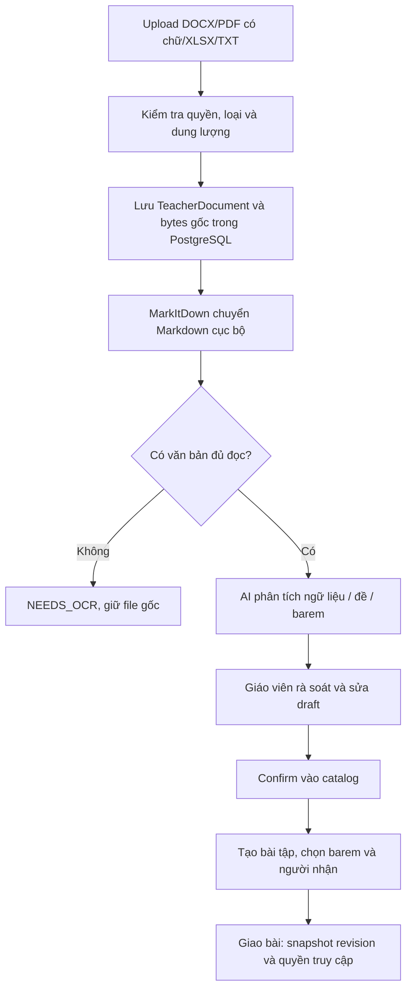

# Luồng học liệu giáo viên và chatbot

Rà lại **2026-10-28** theo router `catalog.py`, `socratic.py`, `chatbot.py` và các service tương ứng. Backend thực thi là Python/FastAPI, SQLAlchemy async, PostgreSQL theo [ADR-0004](decisions/0004-python-monolith.md). Có hai luồng chat khác nhau: hướng dẫn dàn ý Socratic và hỏi đáp tra cứu học liệu/hướng dẫn sử dụng.

## 1. Vị trí code hiện tại

| Thành phần | Vị trí | Vai trò |
| --- | --- | --- |
| Kho và import UI | `frontend/src/features/catalog/`, `frontend/src/app/materials/` | Upload, rà soát, sửa và confirm |
| Socratic UI | `frontend/src/features/socratic/`, `frontend/src/app/assignments/[id]/socratic/` | Chat theo phiên, outline và readiness |
| Chatbot UI | `frontend/src/app/chatbot/`, `frontend/src/features/chatbot/`, `frontend/src/components/FloatingChatWidget.tsx` | Hỏi đáp tài liệu |
| HTTP | `backend/app/api/routers/catalog.py`, `socratic.py`, `chatbot.py` | Route với auth và mutation guards |
| Import | `backend/app/services/document_import.py`, `document_convert.py` | Lưu file gốc, chuyển Markdown, phân tích và confirm |
| Catalog/barem | `backend/app/services/catalog_service.py`, `rubric.py` | Kiểm tra và lưu ngữ liệu, chunks, đề nguồn, rubric/version |
| Giao đề | `backend/app/services/assignment_service.py` | Snapshot ngữ cảnh/barem và quyền theo revision |
| Hội thoại Socratic | `backend/app/services/socratic_service.py`, `backend/app/workflows/` | Reservation, FSM, LangGraph, pre/post guardrail |
| Tra cứu chatbot | `backend/app/services/chatbot_service.py` | Tìm từ khóa, lọc scope, tạo câu trả lời có nguồn |
| AI/persistence | `backend/app/ai/`, `backend/app/db/models/` | Adapter/schema/prompt assets, SQLAlchemy và blobs PostgreSQL |
| Chuẩn bị dàn ý nền | `backend/app/workers/outline_prep.py` | Claim job theo học sinh; helper vòng lặp dùng chung |
| Prompt runtime | `prompts/catalog/`, `prompts/socratic/` | Tách nội dung import và hướng dẫn dàn ý theo phiên bản |

## 2. Giáo viên nhập tài liệu và giao bài

`POST /api/teacher/documents` là multipart field `file`. Upload gọi chuyển đổi và phân tích ngay trong service, không có hàng đợi ingestion riêng. Endpoint `analyze`, `draft`, `confirm` cho phép phân tích lại/lưu bản sửa/xác nhận. Hash Markdown chống dùng kết quả phân tích không khớp nội dung đang sửa. PDF scan không tự gửi Vision; đánh dấu `NEEDS_OCR`.

Catalog có chuyên đề, ngữ liệu/version/chunks, đề nguồn và rubric/version; có thể nhập trực tiếp qua JSON. Barem được validator kiểm tra tổng điểm và tiêu chí trước khi lưu. Không có endpoint privacy-review/process/approve riêng như thiết kế ban đầu. Giáo viên cần kiểm tra nội dung được phép gửi AI; chưa có bộ phát hiện PII tự động được kiểm chứng.

Giao bài pin dữ liệu trong `AssignmentRevision.snapshot`, rubric và context chunks; catalog thay đổi không tự viết lại snapshot đã giao. Chỉ có nội dung trong phạm vi quyền mới được dùng. Xem [luồng giao bài](../development/teacher-assignment-flow.md).

## 3. Socratic theo bài tập

Học sinh có `assignment_access` mới tạo/đọc/mutation session. Service nạp revision, outline và lịch sử, workflow kiểm tra yêu cầu viết hộ, gọi adapter và kiểm tra output/nguồn theo guardrail. Backend quản lý FSM `INIT → THESIS → OUTLINE → REVIEW`; model không tự quyết quyền hoặc ghi database.

Mỗi lượt có reservation và idempotency, tránh tạo hai logical turn khi retry. Sửa outline kiểm tra `expectedVersion`; review dùng revision hiện hành. Chuẩn bị dàn ý có job theo học sinh và worker nền. Response được trả sau kiểm tra, chưa có SSE/streaming. Guardrail heuristic không bảo đảm phát hiện mọi yêu cầu viết hộ; evaluations còn ở M6.

## 4. Chatbot tra cứu

`POST /api/chatbot` nhận `{message}`; trả `{answer, sources}`. Các trường nguồn hiện là snake_case (`chunk_id`, `material_title`, `source_name`), khác nhiều payload camelCase của API nghiệp vụ.

`ChatbotService` chọn chunks theo quyền: giáo viên từ ngữ liệu của mình, học sinh từ snapshot bài được giao còn quyền. Router còn nạp [hướng dẫn sử dụng](../hướng-dẫn-sử-dụng.md) làm nguồn chung. Tìm từ khóa có chuẩn hóa tiếng Việt, ghép tối đa 5 chunks từ hướng dẫn và học liệu rồi gọi adapter. Không có embeddings/vector search hay huấn luyện lại model.

Luồng này không cập nhật FSM/dàn ý của Socratic. Chatbot không có bảng lịch sử hội thoại riêng trong schema hiện tại; UI quản lý hội thoại phía trình duyệt. Không mô tả nó thành bộ nhớ học sinh bền vững phía server.

## 5. Kiểm chứng và mở rộng

Backend có test cho catalog, import, quyền truy cập, chatbot và Socratic; frontend có unit tests theo feature và Playwright tại `frontend/tests/`. Lệnh kiểm tra ở [CONTRIBUTING](../../CONTRIBUTING.md#lint-test-và-ci).

Privacy gate riêng, OCR PDF scan, semantic retrieval và đánh giá chất lượng trên dataset là phần cần bổ sung khi có phạm vi cụ thể. `evaluations/` chưa có runner/dataset; xem [roadmap](../development/implementation-roadmap.md) và [pipeline AI](gemini-pipeline.md).
