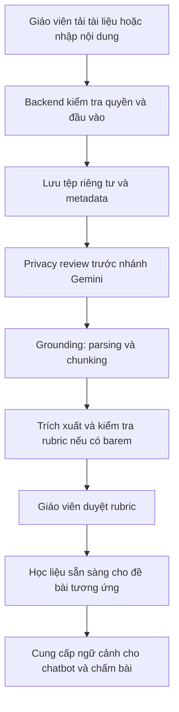
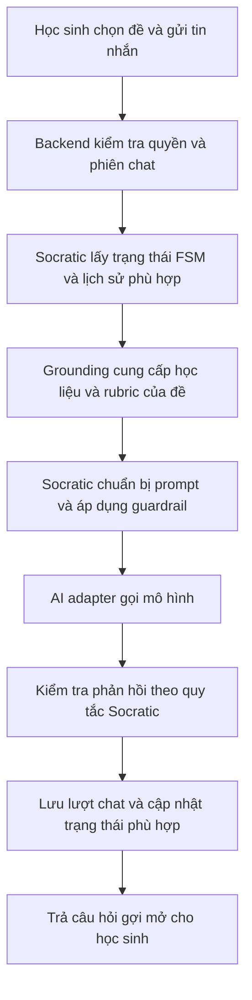

# Luồng học liệu giáo viên và chatbot

Ngày cập nhật: 12/10/2026. Trạng thái: thiết kế triển khai, chưa có pipeline thực thi.

Tài liệu bổ sung cách tổ chức để thực hiện FR-01–FR-10 của [SRS](../../SRS.md). Stack đích là NestJS/TypeScript, PostgreSQL/Prisma, pg-boss và **Gemini 2.5 Flash** theo [system design](system-design.md). Các policy sư phạm/retention còn mở vẫn cần chốt; lựa chọn công nghệ không đồng nghĩa chức năng đã chạy.

## 1. Phân chia trách nhiệm

Cấu trúc `frontend/` và `backend/` phù hợp với hệ thống có chatbot và chức năng giáo viên bổ sung tài liệu. Hai luồng này là các nghiệp vụ phối hợp trong backend, với giao diện tương ứng ở frontend.

| Thành phần | Vị trí | Vai trò |
| --- | --- | --- |
| Giao diện học liệu | `frontend/src/features/grounding/` | Tải tài liệu, nhập nội dung, xem tiến trình xử lý và kiểm tra rubric |
| Giao diện chatbot | `frontend/src/features/socratic/` | Gửi/nhận tin nhắn, chọn đề, hiển thị dàn ý và trạng thái phiên |
| Nhập học liệu | `backend/src/modules/grounding/application/ingestion/` | Tiếp nhận và điều phối parsing, chunking, lưu nội dung/metadata |
| Cung cấp ngữ cảnh | `backend/src/modules/grounding/application/retrieval/` | Chọn học liệu phù hợp với đề và phạm vi truy cập |
| Rubric | `backend/src/modules/grounding/application/rubrics/` | Trích xuất, kiểm tra và cung cấp tiêu chí chấm |
| Hội thoại | `backend/src/modules/socratic/application/conversations/` | Điều phối lượt chat, lịch sử và máy trạng thái lập dàn ý |
| Guardrail | `backend/src/modules/socratic/application/guardrails/` | Áp dụng quy tắc Socratic và xử lý yêu cầu viết hộ |
| Nhà cung cấp AI | `backend/src/infrastructure/ai/` | Tích hợp SDK/API của mô hình được chọn |
| Lưu tệp và dữ liệu | `backend/src/infrastructure/storage/`, `database/` | Tích hợp lưu tệp riêng tư và persistence cho metadata/phiên |
| Tác vụ nhập tài liệu | `backend/src/jobs/ingestion/` | Gọi use case nhập học liệu khi cần xử lý nền |
| Chỉ dẫn mô hình | `prompts/socratic/`, `prompts/grounding/` | Prompt dùng chung có phiên bản |

## 2. Giáo viên bổ sung tài liệu

Trạng thái học liệu gồm `UPLOADED`, `PRIVACY_REVIEW`, `PROCESSING`, `READY`, `FAILED`; rubric có lifecycle riêng `DRAFT → APPROVED`. Giao diện hiển thị trạng thái từ backend; nội dung chưa xử lý xong không được coi là nguồn ngữ cảnh sẵn sàng. Parsing cục bộ có thể thực hiện trước review; chỉ dữ liệu đã qua privacy gate mới được gửi Gemini.

Mỗi học liệu cần metadata về chủ sở hữu, phạm vi lớp/đề, phiên bản và trạng thái xử lý. Tệp được lưu qua storage; nội dung đã trích xuất, chunk và metadata được lưu qua persistence phù hợp. Quan hệ cụ thể cần chốt theo TBD-01, TBD-02 và chính sách lưu trữ theo TBD-06.

Việc tải thêm tài liệu cập nhật kho tri thức và ngữ cảnh của ứng dụng. Luồng này không bao gồm huấn luyện lại hoặc fine-tune mô hình. Cơ chế chọn ngữ cảnh có thể bắt đầu bằng lấy các đoạn theo đề và metadata; nếu cần tìm kiếm ngữ nghĩa trên kho lớn, có thể bổ sung embeddings và adapter tìm kiếm sau khi có yêu cầu cụ thể.

Thiết kế MVP yêu cầu giáo viên kiểm tra/approve rubric do AI trích xuất trước khi giao đề. Giao đề pin assignment/rubric/material versions; sửa phiên bản không đổi lịch sử chấm. Đây là workflow đích, chưa được triển khai.

## 3. Học sinh sử dụng chatbot

Module `socratic` sử dụng interface do `grounding` cung cấp để lấy ngữ cảnh. Việc chọn nội dung dựa trên đúng đề và quyền truy cập; lịch sử chat được gắn với học sinh/phiên. Lịch sử dài cần có chiến lược giới hạn ngữ cảnh khi triển khai, theo khả năng của mô hình và yêu cầu lưu phiên được chốt tại TBD-03.

Nội dung từ tài liệu được xem là dữ liệu tham khảo, không được cấp quyền thay đổi chỉ dẫn hệ thống. Guardrail áp dụng theo BR-01–BR-04; prompt là một phần của cơ chế. MVP buffer nội dung đến khi schema/guardrail đã kiểm tra, rồi mới trả học sinh. Nếu thêm SSE, phát trạng thái và message đã duyệt, không phát raw tokens. TTFT provider và độ trễ nội dung đã duyệt đo riêng; mục tiêu SRS chưa được bảo đảm. Xem [Gemini pipeline](gemini-pipeline.md).

## 4. Phạm vi và phiên bản học liệu

- Xác định tài liệu nào thuộc đề/bài tập và lớp nào, ai có quyền sửa hoặc sử dụng.
- Khi bổ sung hoặc sửa tài liệu, cập nhật nội dung/chỉ mục tương ứng và vô hiệu hóa cache liên quan nếu có.
- Khi sửa rubric, giữ thông tin phiên bản đã dùng cho kết quả chấm trước đó.
- Với phiên chat đang mở, chốt chính sách giữ ngữ cảnh ban đầu hoặc chuyển sang phiên bản mới; không tự thay đổi âm thầm các yêu cầu đề và rubric.
- Nếu dùng tìm kiếm ngữ nghĩa, áp dụng bộ lọc quyền truy cập trước khi nội dung được đưa vào ngữ cảnh mô hình.

Các điểm này cụ thể hóa phần cần thiết kế thêm ở TBD-01–TBD-03. Định danh, schema và chính sách cập nhật vẫn cần được thống nhất trước khi viết chức năng.

## 5. Kiểm tra cần có khi triển khai

| Luồng | Kiểm tra phù hợp |
| --- | --- |
| Tải tài liệu | Định dạng hợp lệ, lỗi parsing, trạng thái xử lý và phạm vi truy cập |
| Bổ sung tài liệu | Nội dung mới chỉ được dùng khi sẵn sàng; lỗi xử lý không làm mất học liệu đang hợp lệ |
| Lấy ngữ cảnh | Đúng đề và phiên bản; không trả dữ liệu thuộc lớp hoặc người dùng ngoài phạm vi |
| Hội thoại | Lịch sử/phiên độc lập, tiến trình FSM và quy tắc hỏi gợi mở |
| Guardrail | Từ chối viết hộ, hạn chế phạm vi phản hồi và xử lý chỉ dẫn không hợp lệ trong học liệu |
| Hiệu năng | Thời gian lấy ngữ cảnh, gọi mô hình và TTFT theo điều kiện kiểm thử đã chốt |

Kiểm thử phần mềm nằm trong `backend/tests`, `frontend/tests` và `tests/e2e`; chất lượng hướng dẫn và tuân thủ sư phạm nằm trong `evaluations/socratic`.
