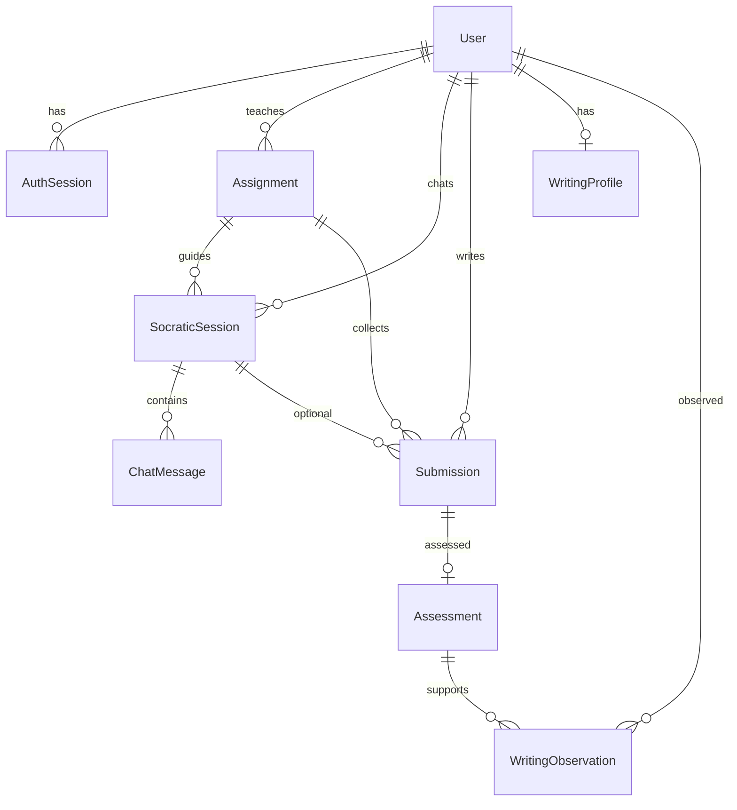

# Database MVP tối giản

Ngày: 13/10/2026. Đây là schema đã triển khai trên nhánh `feat/database`, thu hẹp so với [data-model.md](data-model.md). Quyết định nằm trong [ADR-0002](decisions/0002-minimal-mvp-database.md).

## 1. ERD

Chín bảng nghiệp vụ (`users`, `auth_sessions`, `assignments`, `socratic_sessions`, `chat_messages`, `submissions`, `assessments`, `writing_observations`, `writing_profiles`). `_prisma_migrations` không tính là bảng nghiệp vụ. `assessments.student_id` là cột denormalize để khóa ownership, không phải bảng mới.

## 2. Khóa và ràng buộc

| Bảng | Unique | FK / CHECK |
| --- | --- | --- |
| users | login_id | role TEACHER/STUDENT, status ACTIVE/INACTIVE |
| auth_sessions | token_hash | user_id RESTRICT; expires_at > created_at |
| assignments | code | teacher_id RESTRICT; grade 10–12; max_score > 0; score_step > 0; PUBLISHED ⇒ published_at |
| socratic_sessions | (student_id, assignment_id); (id, student_id, assignment_id) | student/assignment RESTRICT |
| chat_messages | (session_id, sequence) | sequence ≥ 0 |
| submissions | (student_id, assignment_id); (id, student_id) | session kép khớp student+assignment (MATCH SIMPLE khi session null) |
| assessments | submission_id; (id, student_id) | FK kép (submission_id, student_id); điểm ≥ 0; max_score > 0; total_score ≤ max_score |
| writing_observations | (student_id, assessment_id, feature_key) | FK kép (assessment_id, student_id); 0 ≤ start < end |
| writing_profiles | student_id | version ≥ 1 |

Mọi quan hệ `ON DELETE RESTRICT` / `ON UPDATE RESTRICT`. Session token không bị xóa cascade khi vô hiệu hóa user.

## 3. Invariants (validator + transaction)

- Rubric: `weight` là điểm tối đa, không phải hệ số nhân. Tổng weight = maxScore. Điểm theo scoreStep. Giá trị điểm phải khớp `numeric(8,2)` (hai chữ số), không bị làm tròn khi lưu.
- Snapshot: nộp kèm session dùng `contextSnapshot` của phiên; nộp không session dùng assignment `PUBLISHED` hiện tại. Client không tự khai snapshot. Chỉ nhận bài khi đề `PUBLISHED`; `dueAt` không chặn nộp.
- `assessments.rubricSnapshot` phải khớp rubric trong `submissions.assignmentSnapshot`. Không lấy rubric hiện tại của assignment để chấm bài cũ.
- Observation: quote = `submission.text.slice(start, end)` theo UTF-16 JS/TS, khoảng `[start, end)`. Normalize trước khi lưu text; offset luôn trỏ text bất biến.
- Hồ sơ chỉ dùng assessment `PUBLISHED`. Query coaching chỉ lấy `PROVISIONAL`/`SUPPORTED`. `RESOLVED` là lịch sử (`summary.resolvedItems`). `INVALIDATED` không vào hồ sơ. Retry trích xuất không hồi sinh hai trạng thái cuối.
- Support count theo số bài nguồn (assessment) khác nhau, không theo số lần retry cùng input. Ghi profile khóa hàng học sinh trước.
- Version profile tăng trong transaction; `expectedProfileVersion` sai → xung đột, không ghi đè.
- Chat history theo session; unique `(sessionId, sequence)` giữ thứ tự khi timestamp trùng.

## 4. Policy truy cập thí điểm

Một giáo viên sở hữu đề (`assignments.teacher_id`). Học sinh chỉ session/submission/profile của mình. Database không thay thế authorization HTTP. Backend sau này phải kiểm tra role/status trên mọi use case. Tài khoản cấp sẵn, không self-registration, không role admin nhiều tầng.

Local Compose: user bootstrap tạo database. Deployment: role ứng dụng không phải superuser.

## 5. Offset UTF-16

`String.slice` và `String.length` của JavaScript đếm UTF-16 code unit. Emoji (ví dụ 👍) dài 2 đơn vị. Dấu tiếng Việt precomposed (Unicode NFC phổ biến) là một code unit mỗi ký tự. Mọi evidence phải được kiểm tra lại trên đúng chuỗi đã lưu.
