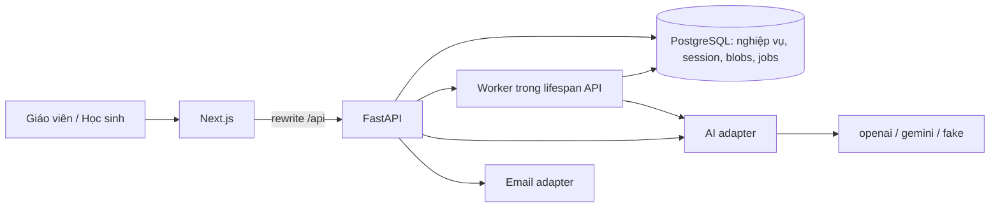
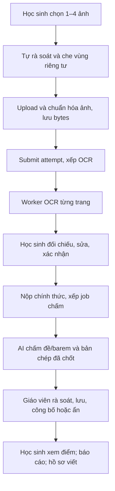

# Kiến trúc và công nghệ EduLit-AI

Rà lại **2026-10-28** theo `backend/app/main.py`, Settings, router/service/model, worker và frontend hiện tại. [ADR-0004](decisions/0004-python-monolith.md) là quyết định backend mặc định; ADR-0001 lưu lịch sử thiết kế cũ.

## 1. Thành phần hiện có

| Thành phần | Thực thi |
| --- | --- |
| Web | Next.js 15 App Router, React 19, TypeScript, Tailwind CSS 3, Recharts |
| State/client | Zustand và fetch API theo feature; store chung chỉ persist sidebar |
| API | Python 3.12, FastAPI, prefix `/api`, Pydantic và validator nghiệp vụ |
| Persistence | PostgreSQL, SQLAlchemy 2 async, Alembic tới revision `0019` |
| AI | OpenAI SDK, Gemini REST, fake; `AI_PROVIDER` và `AI_MODEL` trong Settings; LangGraph cho Socratic |
| Import | MarkItDown cho DOCX/PDF có chữ/XLSX/TXT/Markdown; PDF scan trả trạng thái `NEEDS_OCR` |
| Ảnh/tệp | Canvas trên trình duyệt, Pillow phía backend; tài liệu gốc và ảnh lưu bytes trong PostgreSQL |
| Auth | Argon2id, session PostgreSQL, cookie HttpOnly, kiểm tra Origin và header CSRF |
| Tác vụ nền | OCR, outline-prep, assessment/insights, writing-profile gắn vào lifespan API |
| Kiểm tra/hạ tầng | Ruff/pytest, ESLint/TypeScript/Node tests/Playwright; CI, Dockerfile và Compose đã có |

TanStack Query, Prisma, pg-boss, transactional outbox, GCS và OpenTelemetry không phải thành phần đã triển khai trong code này. `contracts/` và `evaluations/` còn là chỗ dành sẵn cho M6.

## 2. Luồng triển khai hiện tại

Next.js mặc định proxy `/api/*` tới `http://localhost:4000`; `API_PROXY_TARGET` đổi đích. FastAPI có health `/api/health`, Swagger `/docs` khi không phải production và OpenAPI runtime. Không có file đặc tả được xuất trong `contracts/openapi/`.

## 3. Tổ chức nghiệp vụ

`app/identity/` sở hữu auth; `app/api/routers/` định nghĩa HTTP nghiệp vụ. `app/services/` chứa xử lý lớp, catalog, bài tập, Socratic, submission/OCR, assessment, báo cáo, chatbot và hồ sơ viết. `app/db/models/` là model SQLAlchemy; `app/workflows/` chứa LangGraph/guardrail. Chi tiết đường dẫn ở [project structure](project-structure.md).

Quyền nằm tại dependency/service: giáo viên sở hữu tài nguyên/lớp, học sinh có membership/quyền giao đề và chỉ thao tác bài/phiên của mình. `assignment_access` cấp quyền cho revision; mã đề là khóa tra cứu, không thay quyền truy cập.

## 4. Các luồng đã triển khai

### Học liệu và giao bài

Giáo viên tạo ngữ liệu/đề nguồn/barem trực tiếp hoặc upload tài liệu. Upload lưu bytes gốc, chuyển Markdown cục bộ và gọi phân tích qua AI adapter trong luồng request; đây chưa phải worker ingestion bền vững. Giáo viên rà soát rồi confirm vào catalog. PDF scan giữ bản gốc và `NEEDS_OCR`, không có nhánh Vision tự động cho tài liệu nhập.

Giao bài từ đề nguồn tạo `AssignmentRevision` với snapshot đề/barem/ngữ liệu, cấp quyền và chuẩn bị dàn ý theo học sinh. Cập nhật settings bài đã giao đi qua endpoint riêng; code giới hạn trường được sửa. Xem [luồng giáo viên](../development/teacher-assignment-flow.md).

### Socratic và chatbot tra cứu

Socratic giữ session, messages, outline revisions và FSM `INIT → THESIS → OUTLINE → REVIEW`. Lượt chat có reservation/lease và `Idempotency-Key`; lưu outline dùng `expectedVersion`. Workflow kiểm tra đầu vào, gọi adapter, kiểm tra phản hồi/nguồn rồi trả toàn bộ message hoặc fallback. Chưa có streaming/SSE.

Chatbot `/api/chatbot` là luồng khác: tìm từ khóa trên chunks có quyền và tài liệu hướng dẫn sử dụng, rồi tạo câu trả lời có nguồn. Không có vector database/embeddings. Xem [knowledge and chatbot](knowledge-and-chatbot.md).

### Bài nộp, OCR và chấm

`submitted_at` là lúc gửi ảnh OCR; `official_submitted_at` là lúc học sinh xác nhận bản chép. Không có bước giáo viên duyệt OCR. Một bản từng công bố, kể cả đang ẩn, cần giáo viên cấp quyền mới mở lại sửa; grant tiêu thụ khi bắt đầu sửa/nộp lại.

AI payload, teacher payload và published payload tách riêng. Mutation kết quả kiểm tra `resultId`, `transcriptionRevisionId`, `expectedVersion`; bản nộp đã đổi trả conflict. Học sinh chỉ xem điểm đã công bố; báo cáo chính thức dùng `current_published_result_id`.

### Báo cáo và hồ sơ viết

`stats_engine.py` đọc dữ liệu PostgreSQL và tính thống kê bằng Python theo bài/nhiều bài, hai mode `provisional`/`official`, quy điểm về thang 10 khi cần. POST insight xếp job theo dữ liệu/bộ lọc; GET báo cáo không gọi AI. Assessment worker xử lý chấm và class insights.

Hồ sơ viết lấy bài đã công bố và bản chép tương ứng, lưu payload có bằng chứng, source hash và lịch sử phiên bản. GET đọc cache; POST refresh chủ động tổng hợp. Worker riêng tạo hồ sơ đầu tiên cho học sinh đủ dữ liệu, các cập nhật sau do học sinh yêu cầu. Profile không đi vào scoring context. Chưa có bảng goal survey/observation độc lập như thiết kế ban đầu.

## 5. Worker, transaction và lỗi

`ocr.py`, `outline_prep.py`, `assessment.py` dùng helper `_loop.py`: claim trong transaction, chạy job ngoài transaction claim, giới hạn concurrency, poll và chờ các task đang chạy khi dừng. Logic xử lý riêng kiểm tra lease/token trước khi ghi kết quả. Assessment giữ backfill và ưu tiên chấm trước insight trong wrapper riêng.

Writing-profile worker dùng sweep riêng, không có bảng job/lease; thời gian chờ thử lại giữ trong bộ nhớ. Bốn worker đều được lifespan API bật theo Settings, không tự chạy trong test. CLI hiện có cho ba worker claim/lease; khi tách process cần tắt cờ tương ứng trong API. Không bảo đảm provider chỉ được gọi một lần khi crash.

Lỗi HTTP theo `{error: {code, message, fields?}}`, do `app/core/errors.py` và exception handler trong `main.py` tạo. Không có `requestId` trong envelope. Không áp dụng chung một dạng `202/statusUrl` cho mọi tác vụ: các route submission hiện trả payload trạng thái HTTP 200. Chi tiết ở [API design](../api/api-design.md).

## 6. Tài khoản, cấu hình và giới hạn

Đăng ký luôn gán `STUDENT`, đánh dấu email đã xác minh và mở phiên ngay. Giáo viên do CLI bootstrap; endpoint xác minh/gửi lại email vẫn giữ. Production kiểm tra HTTPS, cookie Secure và secret giáo viên; điều kiện kiểm SMTP phụ thuộc adapter và `AUTO_VERIFY_STUDENT`, không điều khiển register. Xem [ADR-0002](decisions/0002-python-auth.md).

Ảnh được người dùng che, backend giải mã/chuẩn hóa; không có privacy-review endpoint hay bộ phát hiện PII tự động được kiểm chứng. File tải qua API có kiểm tra quyền; storage GCS/URL ký là hướng mở rộng. `cleanup-expired` mới xóa session/token/rate-limit bucket hết hạn, chưa là chính sách retention toàn bộ dữ liệu học sinh.

## 7. Hiệu năng và kiểm chứng còn lại

NFR-03/04 là mục tiêu, chưa có benchmark xác nhận. Cần đo thời gian queue/provider/validation và từ nộp đến công bố có người duyệt; không lấy độ trễ mock làm số đo. Evaluations, contracts xuất riêng, quota/usage ledger, backup/restore, retention và triển khai HTTPS thí điểm cần hoàn thiện theo M6 của [roadmap](../development/implementation-roadmap.md).

## 8. Chạy và triển khai

Compose hiện có PostgreSQL 17, Mailpit, API Python và Next.js; host port mặc định lần lượt `5434`, `1025/8025`, `4000`, `3000`. Dockerfile API copy `backend/demo/`, chạy Alembic trước Uvicorn; production lifespan mặc định cũng bật migration nếu không override `RUN_MIGRATIONS`.

Lệnh local/container ở [README backend](../../backend/README.md) và [infra](../../infra/README.md). Staging/production hoàn chỉnh chưa được mô tả như hệ thống đã nghiệm thu. Khi scale nhiều replica cần chốt nơi chạy migration, worker và giới hạn tài nguyên dùng chung.
