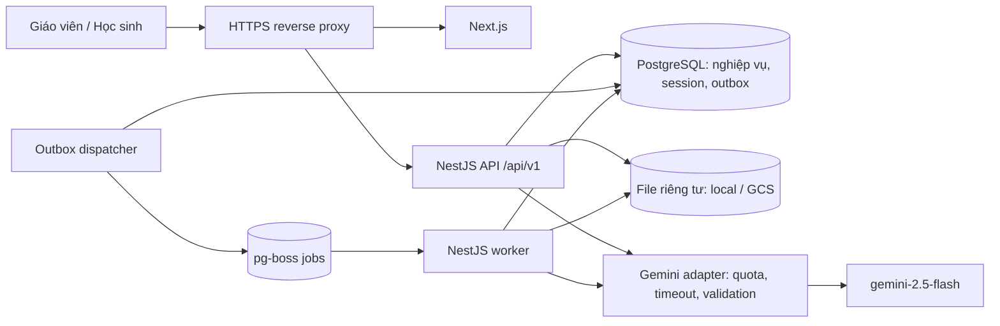
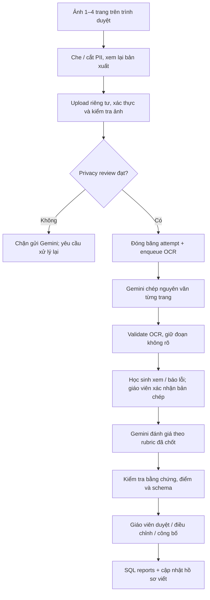

# Kiến trúc và công nghệ EduLit-AI

Ngày: 12/10/2026. Phạm vi: thiết kế triển khai từ prototype Next.js, phục vụ thí điểm một trường và mở rộng nhiều lớp.

Model được người dùng chọn: **Gemini 2.5 Flash**, mã `gemini-2.5-flash`. Các công nghệ còn lại là quyết định thiết kế cho MVP trong [ADR-0001](decisions/0001-mvp-stack.md). Tài liệu này không xác nhận backend, hạ tầng hoặc tích hợp AI đã chạy.

## 1. Mục tiêu và nguyên tắc

- Giữ chu trình prototype: giáo viên chuẩn bị học liệu/rubric → giao đề → học sinh lập dàn ý → nộp ảnh → rà soát OCR → nhận kết quả → giáo viên xem báo cáo.
- Backend là **modular monolith**, có hai tiến trình API và worker dùng cùng mã nghiệp vụ, cùng cơ sở dữ liệu.
- Điểm, quyền truy cập, phiên bản đề và dữ liệu bài nộp có nguồn sự thật ở backend. Trạng thái trình duyệt phục vụ tương tác.
- OCR và chấm là hai tác vụ riêng. Gemini đọc ảnh; lượt chấm dùng bản chép đã được xác nhận.
- Cá nhân hóa từ quan sát có dẫn chứng; độ tin cậy theo từng đặc điểm, không hứa hồ sơ hội tụ sau một số bài cố định.
- Tính thống kê bằng SQL; Gemini chỉ đề xuất hành động sư phạm từ số liệu đã tính.

## 2. Công nghệ lựa chọn

| Thành phần | Lựa chọn | Lý do và phạm vi |
| --- | --- | --- |
| Web | Next.js 15 App Router, React 19, TypeScript hiện có | Tiếp tục prototype, tránh dựng lại giao diện; rà soát bản vá trước triển khai thật |
| UI | Tailwind CSS 3 hiện có, Recharts | Giữ design tokens và biểu đồ đang dùng |
| State | Zustand cho UI; TanStack Query cho dữ liệu API | Tách sidebar/draft tương tác khỏi cache dữ liệu máy chủ |
| Backend | NestJS, TypeScript, HTTP adapter Express | Module, dependency injection, guard phân quyền và kiểm thử theo nghiệp vụ |
| Runtime/gói | Node.js 24 LTS, npm | Khóa patch khi scaffold, ghi `.nvmrc`, `engines` và lockfile; giữ lockfile frontend hiện có |
| Database | PostgreSQL 17 | Quan hệ lớp/đề/bài nộp, transaction, JSONB, báo cáo SQL |
| ORM | Prisma; SQL migration cho constraint/index đặc thù | Kiểu truy cập dữ liệu, lịch sử migration, transaction |
| Background jobs | pg-boss, schema riêng trong PostgreSQL | Hàng đợi bền vững cho nhập tài liệu/OCR/chấm, giảm số dịch vụ vận hành MVP |
| AI | Gemini 2.5 Flash qua Google GenAI SDK `@google/genai` | Một model, nhiều prompt và schema theo tác vụ; gọi từ backend |
| Validation | JSON Schema + Ajv | Kiểm tra contract HTTP/AI; quy tắc nghiệp vụ kiểm tra thêm bằng mã |
| Tài liệu | `pdfjs-dist`, Mammoth cho DOCX, UTF-8 cho TXT | Trích xuất cục bộ; PDF scan có nhánh Vision đã kiểm tra quyền riêng tư |
| Ảnh | Canvas ở trình duyệt; Sharp ở worker | Che bằng vùng đặc, xuất ảnh phẳng; kiểm tra, xoay và chuẩn hóa trên máy chủ |
| Đăng nhập | Tài khoản cấp trước, Argon2id, session lưu PostgreSQL | Phù hợp thí điểm; cookie HttpOnly/Secure, thu hồi phiên được |
| File | Adapter filesystem riêng tư khi dev; Google Cloud Storage khi staging/production | Tách tệp khỏi web public; quyền tải qua API/URL ký ngắn hạn |
| Quan sát | Pino, OpenTelemetry, error tracking có lọc dữ liệu | Theo dõi request/job/model latency, token và lỗi; không log bài làm thô |
| Kiểm tra | Jest/Supertest cho backend; Vitest/Testing Library cho frontend; Playwright cho E2E | Kiểm tra nghiệp vụ, tích hợp, luồng người dùng và guardrail |
| Dev/deploy | Docker Compose khi dev; Next.js/API/worker trên VM container khi thí điểm | Worker thường trú để nhận job; PostgreSQL managed, GCS và HTTPS ở môi trường thật |

Đây là danh sách lựa chọn để triển khai; package chưa được cài mới trong đợt thiết kế này. Không cần Redis, vector database hay framework agent để chạy MVP. Nếu quy mô đòi hỏi tìm kiếm ngữ nghĩa, đánh giá embeddings và pgvector trong ADR riêng; không đưa thêm model vào phạm vi hiện tại.

Tài liệu nền: [NestJS Modules](https://docs.nestjs.com/modules), [pg-boss](https://github.com/timgit/pg-boss), [Google GenAI SDK](https://ai.google.dev/gemini-api/docs/libraries), [Node.js releases](https://nodejs.org/en/about/previous-releases). Node.js 24 là dòng LTS tại thời điểm thiết kế, đáp ứng yêu cầu Node ≥22.12 của pg-boss hiện tại; phiên bản dependency cụ thể vẫn cần kiểm tra tích hợp và khóa khi scaffold.

## 3. Sơ đồ triển khai

`pg-boss` dùng cùng PostgreSQL trong schema riêng; sơ đồ tách hộp để thể hiện trách nhiệm. Dispatcher có thể chạy cùng worker. Next.js không giữ API key; `/api/v1` được proxy trực tiếp đến NestJS trên cùng origin. Giữ host/forwarded headers đúng và cấu hình `trust proxy` giới hạn để cookie Secure/rate limit hoạt động đúng.

## 4. Ranh giới module

| Module | Dữ liệu sở hữu / trách nhiệm | Phụ thuộc được phép |
| --- | --- | --- |
| `identity` | User, session, role, đăng nhập/thu hồi phiên | Database, password hasher |
| `classrooms` | School, classroom, membership | Identity interface |
| `assignments` | Đề, mã đề, revision, giao bài, hạn nộp | Classroom access, rubric/material read interfaces |
| `grounding` | Material/version/chunk, rubric/version, xác nhận giáo viên | File, parser, AI, classroom access |
| `socratic` | Session, FSM, message, outline/version | Assignment context, grounding, writing-profile read interface, AI |
| `assessment` | Submission/attempt, page, OCR revision, grading revision, công bố | Assignment snapshot, file, Vision/AI, jobs |
| `writing-profile` | Observation, evidence, profile snapshot, tiến bộ | Assessment events/read interface; AI |
| `analytics` | Read model báo cáo, taxonomy lỗi, đề xuất dạy học | Kết quả assessment đã công bố, assignment learning goals |

Một module không ghi trực tiếp bảng của module khác. Các interface ứng dụng cung cấp dữ liệu có kiểm soát quyền; event/outbox điều phối phần nền. Domain không import NestJS, Prisma hoặc SDK Gemini. Controller kiểm tra đầu vào/quyền rồi gọi use case, không tự chấm hoặc cập nhật FSM.

## 5. Các luồng chính

### 5.1. Học liệu, rubric và giao đề

1. Giáo viên nhập văn bản hoặc tải PDF/DOCX/TXT; backend kiểm tra membership, định dạng thực, kích thước và tình trạng chứa PII.
2. Worker trích xuất cục bộ, giữ vị trí trang/đoạn. Tài liệu scan đi qua privacy review trước khi gửi Gemini.
3. Gemini đề xuất rubric JSON; Ajv kiểm tra hình dạng; mã nghiệp vụ kiểm tra ID tiêu chí, tổng điểm và giới hạn từng mức.
4. Giáo viên sửa/xác nhận rubric. Chỉ rubric `APPROVED` và học liệu `READY` mới được đưa vào revision giao đề.
5. Giao đề tạo revision bất biến, chốt rubric version, material versions, instructions và learning goals. Sửa đề đã giao tạo revision mới có quy tắc áp dụng rõ ràng.

### 5.2. Socratic

1. Backend kiểm tra học sinh thuộc lớp được giao đề, nạp revision và rubric đã chốt.
2. Ngữ cảnh gồm đúng học liệu của đề, outline hiện tại, lịch sử gần nhất và một vài observation liên quan. Truy xuất theo metadata/assignment trước; chọn đoạn theo section/keyword khi vượt budget.
3. Use case giữ FSM `INIT → THESIS → OUTLINE → REVIEW`; model đề xuất bước tiếp theo, backend kiểm tra điều kiện chuyển. Học sinh sửa dàn ý có thể quay lại bước phù hợp.
4. Gemini trả response có cấu trúc gồm câu hỏi, source references và đề xuất cập nhật outline. Ý thêm vào outline cần học sinh chủ động chấp nhận và có nguồn từ ý học sinh.
5. Guardrail kiểm tra không viết hộ, không quá 4 câu, kết thúc bằng câu hỏi, tham chiếu nguồn hợp lệ. Nếu không đạt, dùng câu hỏi dự phòng đã duyệt hoặc thử sửa một lần có giới hạn.
6. Chỉ phát `message.completed` sau validation; trạng thái `accepted/generating` có thể phát sớm. Không gửi thẳng token chưa kiểm tra từ Gemini tới học sinh.

MVP lưu toàn bộ message vào database nhưng chỉ đưa một phần thích hợp vào model. Readiness của outline được giáo viên cấu hình theo rubric; không gán số lượt chat cố định. Quy tắc nộp khi chưa hoàn tất outline vẫn cần được chốt theo TBD-03.

### 5.3. Bài nộp, OCR và chấm

- Upload lưu trạng thái nháp; chỉ submit khi đủ trang, thứ tự, quyền riêng tư và điều kiện nộp. Không chấp nhận riêng cờ `piiMasked` của client làm bằng chứng ảnh đã sạch.
- Không gửi ảnh gốc lên public bucket; backend giải mã và xuất lại ảnh phẳng, loại EXIF. Thí điểm dùng bước rà soát của người có quyền trước lần gửi ra ngoài; tự động hóa privacy gate cần bộ đánh giá riêng.
- PII có thể nằm trong thân bài. Crop header và regex không chứng minh đã ẩn danh hoàn toàn; trường hợp còn nghi ngờ phải dừng để rà soát. Nội dung văn bản/học liệu/chat cũng được lọc trước các lượt model sau.
- Sau submit, học sinh không tự viết lại nội dung. Học sinh báo vị trí OCR sai; giáo viên sửa có audit và tạo transcription revision mới.
- Mọi trang dùng `pageId`, `pageIndex`, `segmentId`; số dòng chỉ phục vụ hiển thị trong một revision. Tọa độ do model đề xuất không được coi là vị trí chính xác đã kiểm chứng.
- `confidence` do Gemini tự báo không là xác suất OCR đúng đã hiệu chuẩn. MVP dùng `needsReview`, lý do và xác nhận; giá trị số nếu lưu phải ghi rõ nguồn, có thể `null`.
- AI tạo **điểm đề xuất**. Kết quả chính thức của MVP đi qua giáo viên; thông báo/giao diện phân biệt draft với published.
- Bài nộp mới, rubric mới hoặc bản chép sửa không tự thay thế kết quả cũ. Xem [mô hình dữ liệu](data-model.md).

### 5.4. Báo cáo và hồ sơ viết

`assessment.published` tạo outbox event trong cùng transaction. Analytics tính số bài, điểm trung bình, phân bố và tần suất lỗi từ tập kết quả hiện hành đã công bố. Lớp chưa có dữ liệu trả empty state; denominator và nhóm bài được ghi rõ.

Writing profile tách **mục tiêu tự khai báo**, **năng lực**, **khuynh hướng diễn đạt** và **lỗi cần luyện**. Mỗi observation dẫn tới bài/đoạn cụ thể, genre và thời điểm. Khi kết quả bị rút hoặc bản chép thay đổi, observation liên quan bị vô hiệu hóa và snapshot được xây lại. Chỉ dùng bài hợp lệ khi tính tiến bộ; không so điểm thô giữa hai rubric khác nhau như cùng thang năng lực.

## 6. Job, transaction và lỗi

- Transaction submit lưu attempt bất biến, trạng thái và outbox. Dispatcher enqueue với khóa tác vụ; event được đánh dấu đã giao sau enqueue, có thể giao lại nếu crash.
- Worker kiểm tra trạng thái/version trước và sau gọi AI. Unique constraint cho logical task + input revision ngăn công bố hai kết quả cùng tác vụ. Không giữ database transaction trong lúc chờ Gemini.
- Xử lý thực tế theo hướng at-least-once; không hứa exactly-once với API bên ngoài. Crash sau Gemini trước commit có thể gây lượt gọi và chi phí lặp; giảm bằng job lease, checkpoints và retry budget.
- Chia queue `material-ingestion`, `ocr`, `grading`, `profile-refresh`, `analytics-recommendation`, `retention-cleanup`; giới hạn concurrency theo quota đã đo của project.
- Retry có backoff/jitter cho lỗi tạm thời `429/5xx/network`, tôn trọng `Retry-After` nếu có. Sai quyền model/key, lỗi đầu vào hoặc safety block không retry vô hạn.
- Một lần sửa output sai schema/bằng chứng tối đa trong budget; nếu tiếp tục lỗi, chuyển `FAILED` hoặc manual review, không ghép báo cáo thiếu như hợp lệ.
- Retry luôn giữ cùng model, input revision, rubric version và prompt version. Không tự chuyển sang model khác.
- Giới hạn request/job timeout, số lần thử, token và chi phí là cấu hình nội bộ; UI có trạng thái chờ/thất bại rõ và retry được kiểm tra quyền.

## 7. Bảo mật và vận hành

Quyền được kiểm tra ở mỗi endpoint và mỗi lần đọc tài nguyên: teacher của đúng lớp; student chỉ bài/phiên của mình; cùng school không tự có quyền đọc. Mã đề hoặc UUID không thay thế authorization. Worker tải dữ liệu theo phạm vi sự kiện đã xác minh.

Session opaque lưu hash token và expiry trong PostgreSQL, xoay khi đăng nhập/đổi quyền, thu hồi khi logout. Cookie HttpOnly/Secure/SameSite, CSRF token và Origin checks cho mutation; cùng origin không thay thế CSRF protection. Tài khoản demo không được bật trong môi trường thật. Giới hạn đăng nhập, upload, lượt chat và số job theo user/project.

File không thực thi macro/HTML/script từ tài liệu. Giới hạn file, số trang parser, độ phân giải ảnh, giải nén DOCX và thời gian xử lý; không fetch URL bất kỳ do học sinh cung cấp. Tên file/key không chứa tên học sinh. Prompt coi bài làm và học liệu là dữ liệu không đáng tin, không có quyền sửa system instruction.

Log chỉ metadata: `requestId`, `jobId`, task, model, phiên bản, latency, token và mã lỗi. Không log ảnh, bài làm, tên/email, cookie/key hoặc response thô. Dashboard cần queue age, error/retry rate, guardrail failures, schema failures, quota và chi phí.

Retention là chính sách cần người phụ trách sản phẩm chốt theo TBD-06. Trước khi thí điểm phải có cleanup job, thu hồi file links và xóa dữ liệu dẫn xuất/cache/provider files cùng cơ chế backup expiry. Không lấy số ngày minh họa làm cam kết lưu giữ chính thức.

## 8. Hiệu năng và chi phí

NFR-03 (TTFT ≤1.2s) và NFR-04 (hai trang ≤20s) được giữ là mục tiêu, chưa được bảo đảm. Với Socratic buffer toàn bộ output để guardrail, thời gian học sinh nhận nội dung sẽ dài hơn TTFT của provider; không tính event trạng thái như token nội dung để tuyên bố đạt.

Đo riêng: queue wait, privacy/manual-review wait, preprocessing, provider first token, provider completion, validation, response delivery. Báo cáo cả thời gian OCR/chấm tự động và thời gian từ submit đến công bố có người duyệt. Mục tiêu 20s phải được xác định bao gồm gì, không dùng phần tự động thay cho end-to-end SRS khi chưa thống nhất TBD-08.

Giảm chi phí bằng lọc ngữ cảnh đúng đề, giới hạn output, giới hạn số lượt sửa, lưu kết quả theo input hash/version và tránh chấm lại toàn bộ khi tác vụ không thay đổi. Usage ledger dự trù trước lượt gọi và đối soát token thực tế; giá không hard-code trong nghiệp vụ. Không dùng sessionStorage để lưu kết quả thật hoặc đẩy một triệu token chỉ vì context model cho phép.

## 9. Triển khai theo môi trường

| Môi trường | Dịch vụ | Dữ liệu |
| --- | --- | --- |
| Development | Frontend/API/worker local; PostgreSQL qua Docker Compose; file ở `var/` | Fixture giả lập; Gemini chỉ khi bật rõ chế độ real |
| Staging | Container frontend/API/worker, PostgreSQL managed, GCS bucket riêng | Dataset đã rà soát quyền riêng tư; quota/secret riêng |
| Pilot production | HTTPS proxy + frontend/API/worker trên VM; PostgreSQL managed; GCS; secret manager | Tài khoản cấp trước; audit, backup/restore, cleanup đã kiểm tra |

Một image backend có hai entrypoint API/worker. Worker chạy thường trú, không gắn vòng đời vào serverless request. Không dùng filesystem container làm storage lâu dài. Mỗi môi trường có DB/bucket/API credentials riêng; migration chạy một lần trước rollout, không để mọi replica tự migrate.

Các bước thực hiện và tiêu chí hoàn thành ở [lộ trình triển khai](../development/implementation-roadmap.md); endpoint ở [API design](../api/api-design.md); cấu hình model ở [Gemini pipeline](gemini-pipeline.md).
